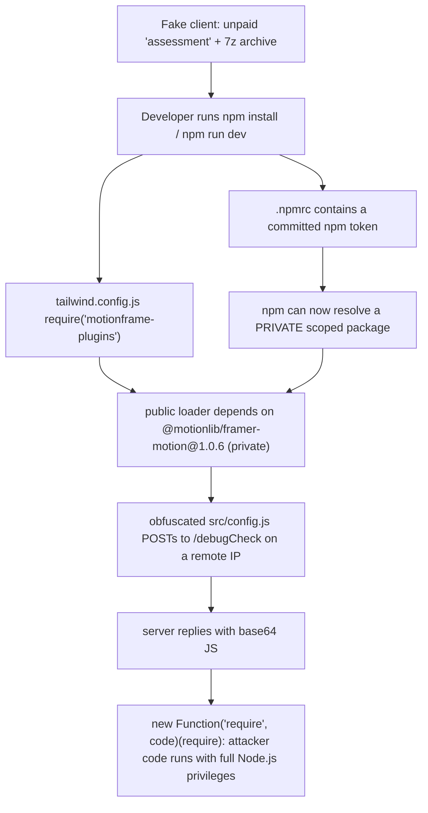

# ⚠️ Fake-Interview npm Lure: Security Advisory

**Published by [Scam Buster India](https://scambuster.ind.in) · Pushkar Sharma · 18 November 2026**
**Status:** static analysis only · nothing was executed · contact: security@scambuster.ind.in

> **TL;DR:** A "coding assignment" sent to a freelance developer (Fiverr, unpaid, pre-contract) hid a remote-code-execution loader in its dependency chain. Running `npm install` + `npm run dev` would have fetched and executed JavaScript from an operator-controlled server. **Do not run unknown assessment repos on your real machine.**

---

## 🇮🇳 हिंदी सारांश

एक फ्रीलांसर को "2–3 घंटे का फ्री coding test" भेजा गया। प्रोजेक्ट असली दिखता था, लेकिन उसकी dependencies में छुपा हुआ malware था, जो `npm run dev` चलाते ही किसी remote server से code मंगाकर आपके कंप्यूटर पर चला देता। हमने उसे **चलाया नहीं**, सिर्फ पढ़कर जाँचा। अगर आपको भी ऐसा कोई test मिले: पहले `package.json` और `.npmrc` पढ़ें, और असली laptop पर कभी न चलाएँ। रिपोर्ट: cybercrime.gov.in · हेल्पलाइन 1930।

---

## What happened

| | |
|---|---|
| **Channel** | A new Fiverr client account offered a $50–70/hr Next.js + Supabase contract |
| **The ask** | Free 2–3 hour "practical task" **before** any contract/NDA; Fiverr custom order declined; finished work to be uploaded to a public Google Drive link |
| **Delivery** | A 7z archive of a realistic, large Next.js 16 + Supabase application (branded "Kontrora") via Google Drive |
| **The trap** | Hidden in the dependency layer, not in the app code |

> **Attribution note:** This advisory describes **technical findings only**. It does **not** prove who operated the account or the server, and the "Kontrora" brand on the lure may itself be impersonated. Please do not harass any individual or company on the basis of this document.

## How the attack works



Key points:

1. **No install script is used.** `npm install --ignore-scripts` does **not** protect you. The code runs when Tailwind loads its config (`npm run dev`, `npm run build`).
2. **A plaintext npm token is committed in `.npmrc`**. It exists so the private dependency resolves, and `.npmrc` also contains lines that silence warnings (`audit=false`, `loglevel=error`).
3. **The private package is invisible to public scanners.** `@motionlib/framer-motion` returns 404 without the token.
4. **`tailwind.config.js` swallows errors** and prints a warning that names an *unrelated* package, so a failed or suspicious load looks harmless.

## Indicators of compromise (summary)

Full list in [`IOCs.md`](IOCs.md).

| Type | Value |
|---|---|
| Public npm loader | `motionframe-plugins@1.0.7` |
| Private npm package | `@motionlib/framer-motion@1.0.6` |
| Payload file | `src/config.js` · 158,936 bytes · SHA-256 `cddec7017154aebf01b317099add0b2d0adc2d1a964f601816f03782db00a743` |
| C2 endpoints (defanged) | `216[.]126[.]231[.]70:1224` · `153[.]75[.]88[.]215:1224` · path `/debugCheck` (HTTP POST) |
| Lure archive | `full-stack-assignment.7z` · SHA-256 `2db16f7d821af983b39be1ab2a838a4cc13bf038fab710dc6047177a6f6ed227` |

## Am I affected? (safe checks: nothing is executed)

```bash
# macOS / Linux
grep -rn "motionframe-plugins\|@motionlib" package.json package-lock.json tailwind.config.* 2>/dev/null
grep -n "_authToken" .npmrc 2>/dev/null
```

```powershell
# Windows PowerShell
Select-String -Path package.json,package-lock.json,tailwind.config.* -Pattern "motionframe-plugins|@motionlib"
Select-String -Path .npmrc -Pattern "_authToken"
```

If anything matches: **do not run** `npm install`, `npm run dev` or `npm run build`. If you **already ran** it, read [`DETECTION.md`](DETECTION.md).

## Report it

Who to report to and ready-made text you can paste: [`REPORTING.md`](REPORTING.md).

- 📦 **npm:** package page of `motionframe-plugins` → *Report malware*
- 🇮🇳 **India:** [cybercrime.gov.in](https://cybercrime.gov.in) · helpline **1930** · CERT-In `incident@cert-in.org.in`
- 💼 The platform where you were contacted (Fiverr / LinkedIn / etc.)

### Disclosure status

Reports have been or are being sent to the recipients below. Status is updated here as responses arrive.

| Recipient | Status | Date |
|---|---|---|
| npm Security | Pending | |
| Fiverr Trust & Safety | Pending | |
| CERT-In | Pending | |
| Google Drive (abuse) | Pending | |
| OpenSSF malicious-packages | Pending | |

## Related public research (same technique family)

This lure matches the fake-interview / private-scoped-npm pattern already documented in 2026. **Same technique ≠ same operator**; we make no claim that they are linked.

- OSV [MAL-2026-17665](https://osv.dev/vulnerability/MAL-2026-17665), [MAL-2026-17666](https://osv.dev/vulnerability/MAL-2026-17666), [MAL-2026-17667](https://osv.dev/vulnerability/MAL-2026-17667)
- Corgea research: [tailwind-animatecss fake-interview private-scope npm (Oct 2026)](https://corgea.com/research/tailwind-animatecss-fake-interview-private-scope-npm-october-2026)

At the time of writing, `motionframe-plugins` and `@motionlib/framer-motion` were **not found** in the public advisories we searched. Please check again before relying on this.

## Repository contents

| File | What it is |
|---|---|
| [`REPORT.md`](REPORT.md) | Full technical report: findings, method, limits |
| [`IOCs.md`](IOCs.md) | All indicators + machine-readable block |
| [`DETECTION.md`](DETECTION.md) | How to check, and what to do if you ran it |
| [`REPORTING.md`](REPORTING.md) | Where/how to report, with paste-ready text |
| [`evidence/`](evidence/) | Redacted proof excerpts + SHA-256 hashes |

## What is deliberately **not** published

The original archive, the plaintext npm token, the full obfuscated payload, the private tarball, chat screenshots with identities, and any individual's personal details. Verified researchers/platform security teams can request the withheld artifacts at **security@scambuster.ind.in** (we can prove possession by hash; see [`evidence/README.md`](evidence/README.md)).

## Rules for any take-home test

1. Read `package.json`, lockfiles, `.npmrc` and build configs **before** installing anything.
2. A committed auth token is a red flag.
3. Use a throwaway VM/container with none of your own credentials.
4. Keep unpaid work small and inside the platform's payment protection.
5. Never upload your work or credentials to links you don't control.

## Corrections & license

Found an error? Email security@scambuster.ind.in. Text in this repo may be shared with attribution to *Scam Buster India*.
